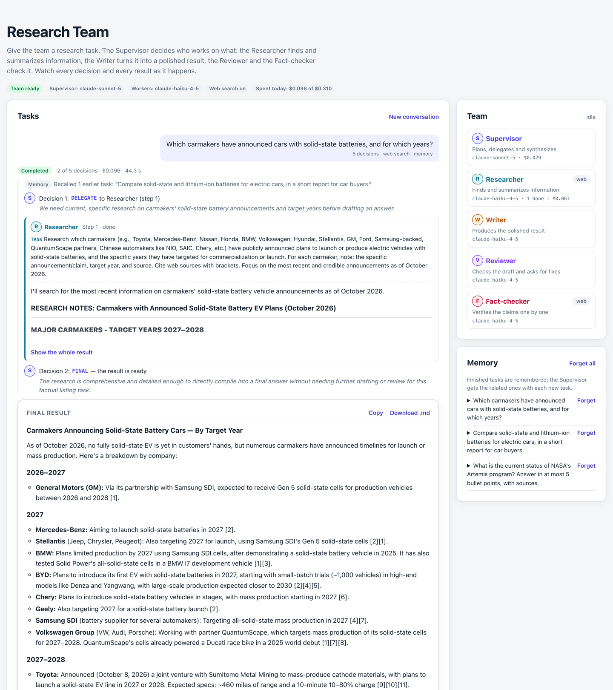
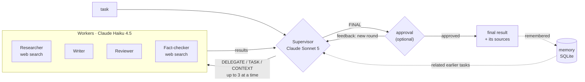
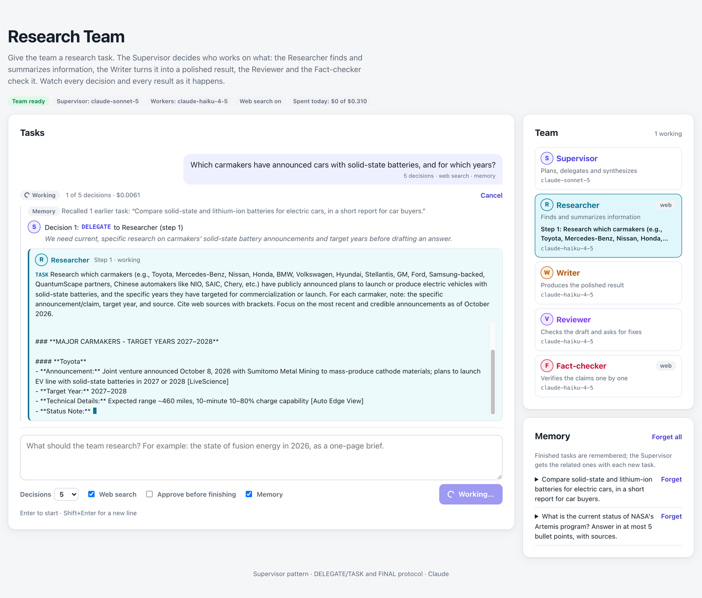
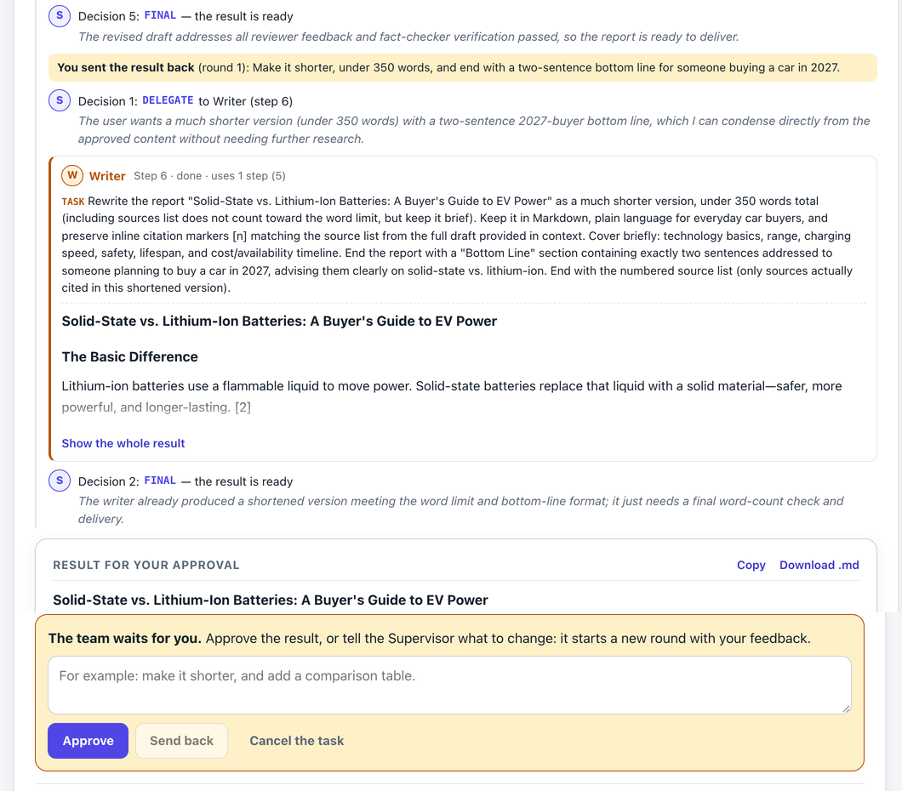

# Research Team — Lab 05: Multi-Agent Orchestration

A small research assistant built with the **supervisor pattern**. A **Supervisor** (Claude Sonnet 5) reads the task and decides, one step at a time, which worker does what. Four **workers** (Claude Haiku 4.5) do the work: the **Researcher** finds and summarizes information with web search, the **Writer** turns it into the polished result, and the **Reviewer** and the **Fact-checker** check it. The Supervisor delegates with `DELEGATE:`/`TASK:` lines, several at once when the work is independent, and finishes with `FINAL:`, synthesizing the workers' results; after `max_iterations` decisions it must finish. A **FastAPI** backend runs the team and streams every decision and every word as Server-Sent Events; a **Next.js** chat page shows who is working, the conversation of decisions and results, and the formatted final result.



## Requirements

| Requirement | Where |
| --- | --- |
| `POST /run` accepting `{"task": "...", "max_iterations": 5}` | [`backend/app/main.py`](backend/app/main.py): answers with the final result, the Supervisor's decisions and the workers' steps. `POST /runs` does the same in the background, followed live through an event stream |
| Supervisor that parses the task and decides which worker to delegate to | [`agents/supervisor.py`](backend/app/agents/supervisor.py), prompt in [`prompts/supervisor.md`](backend/app/prompts/supervisor.md): each decision is one model call that sees the task and every step so far with its result |
| DELEGATE/TASK format for delegation | [`agents/protocol.py`](backend/app/agents/protocol.py): `REASON`, then `DELEGATE`, `TASK` and `CONTEXT` lines per delegation |
| FINAL format for completion | [`agents/protocol.py`](backend/app/agents/protocol.py): everything after `FINAL:` is the result |
| Synthesizes results from all workers | The FINAL answer is written from every step's result; the system adds the list of the sources it cites ([`citations.py`](backend/app/citations.py)) |
| Worker agents (at least 2), each with a specialized system prompt | Four, in [`agents/workers.py`](backend/app/agents/workers.py): [`researcher.md`](backend/app/prompts/researcher.md), [`writer.md`](backend/app/prompts/writer.md), [`reviewer.md`](backend/app/prompts/reviewer.md), [`fact_checker.md`](backend/app/prompts/fact_checker.md) |
| Workers accept task + context and return a result | `Worker.run(task, context)`: the context is the results of the steps the Supervisor lists in `CONTEXT` |
| Iteration limit with forced completion | [`orchestrator.py`](backend/app/orchestrator.py): after `max_iterations` decisions the Supervisor must answer FINAL; if it still cannot, the latest draft is the result. Either way the result is marked *forced* |
| Health check endpoint | `GET /health` |
| Chat-like web interface to submit research tasks | [`ChatPanel.tsx`](frontend/src/components/ChatPanel.tsx), [`Composer.tsx`](frontend/src/components/Composer.tsx) |
| Real-time agent activity feed showing which agent is working | [`ActivityFeed.tsx`](frontend/src/components/ActivityFeed.tsx) (each agent's text appears as it is written) and [`TeamPanel.tsx`](frontend/src/components/TeamPanel.tsx) (who works on which step), fed by Server-Sent Events ([`useRuns.ts`](frontend/src/lib/useRuns.ts), [`run.ts`](frontend/src/lib/run.ts)) |
| Conversation history showing Supervisor decisions and Worker results | [`ActivityFeed.tsx`](frontend/src/components/ActivityFeed.tsx): every decision with its reason, every step with its task, the steps it used and its result; the tasks of the session stay on the page |
| Final output panel with formatted result | [`FinalOutput.tsx`](frontend/src/components/FinalOutput.tsx): Markdown, copy, download as `.md`, and every page the workers cited |
| Responsive design | Two columns from 64rem, one below ([on a phone](docs/mobile.png)); light and dark themes |
| Deployed to Vercel/Railway/Render | [Deploy](#deploy): `backend/railway.json` and the Vercel steps |

All four extension ideas are done:

| Extension | How |
| --- | --- |
| Parallel workers | A decision may delegate up to 3 independent pieces of work, such as research on separate subtopics, or a review and a fact-check of the same draft. They run at the same time, and the next decision waits for all of them. |
| Human approval | With *Approve before finishing*, a FINAL result waits for the user: approve it, or send it back with feedback. Feedback starts a new round in which the Supervisor sees the rejected result and what to change (3 rounds at most). |
| Memory | A completed task is kept in SQLite: the task and the first 1,500 characters of its result. A new task recalls up to 3 related notes for the Supervisor (a word-overlap similarity of at least 0.2); the page lists the notes and can forget them. |
| More workers | The **Reviewer** answers `VERDICT: APPROVE` or `REVISE` with numbered fixes; the **Fact-checker** marks each claim SUPPORTED, UNSUPPORTED or WRONG, against the notes and the web. |

Beyond the brief: web search whose sources are numbered and listed by the system rather than by the models, today's date in every prompt, cancellation that stops a model mid-sentence, spending caps per task and per day, and rate limits.

## How it works



**The decision loop** ([`orchestrator.py`](backend/app/orchestrator.py)). When memory is on, the related earlier tasks are recalled first. Then each decision is one call to the Supervisor with the whole picture rebuilt from the run: today's date, the task, the recalled notes, the user's feedback with the rejected result (in a feedback round), and every step with its task and its result or error, then `Decision 2 of 5.` A delegating answer creates the steps; one runs alone, several run in a thread pool. A worker's failure is recorded on its step for the Supervisor to see, and the run goes on. A FINAL answer ends the round: with approval it waits for the user; otherwise it completes and is remembered.

**Forced completion.** The last decision is told that it is the last one. When the decisions run out without a FINAL, the Supervisor gets one more call: *You have used all your decisions. Answer now with FINAL: the best final result you can write from the task and the steps above.* If it delegates again even then, the latest Writer draft (or else the latest result) is the final result. A forced result carries a note that says why.

**The protocol** ([`agents/protocol.py`](backend/app/agents/protocol.py)). A decision of run 2 below, rebuilt from what the run recorded (tasks shortened), delegates two checks of the same draft at once:

```text
REASON: The draft is ready and should be checked for accuracy against the research notes and for overall quality before finalizing.
DELEGATE: fact_checker
TASK: Verify the factual claims in the provided draft report ("Solid-State vs. Lithium-Ion Batteries: A Buyer's Guide to EV Power") against the provided research notes. Check especially the numeric figures …
CONTEXT: 1, 2
DELEGATE: reviewer
TASK: Review the draft report (…) against the original task (a short report for car buyers comparing solid-state and lithium-ion EV batteries) and the research notes. Check scope coverage …
CONTEXT: 1, 2
```

and the Supervisor's last answer in run 5, as it wrote it:

```text
REASON: The research and draft are sufficiently detailed and well-sourced for a concise status update; no further review needed given the task's simplicity and remaining decision budget.
FINAL:
# NASA's Artemis Program Status (October 2026)

- **Artemis II Complete:** NASA's second crewed mission successfully concluded on April 10, 2026, after a 9-day flight in which astronauts Reid Wiseman, Victor Glover, Jr., Christina Koch, and Jeremy Hansen orbited the Moon and flew within 8,000 kilometers of its surface [1][3][4]. The mission's scientific data was released to the global science community on October 7, 2026 [5].
…
```

`CONTEXT` lists the numbers of earlier steps, `none` or `all` (the default); a worker only ever gets steps that completed. The parser accepts what models add around the keywords (Markdown emphasis, list markers, letter case, `Fact-Checker` for `fact_checker`) and refuses anything else with a message that says what is wrong: neither DELEGATE nor FINAL, an unknown worker, a DELEGATE without a TASK, a TASK without a DELEGATE, DELEGATE and FINAL together, an empty FINAL, more than 3 delegations. A refused answer is sent back once with that message; a second one ends the decisions, and forced completion follows.

**The workers** ([`agents/workers.py`](backend/app/agents/workers.py)). Each is a system prompt over Claude Haiku 4.5; a worker sees only its TASK and the results of the steps in its CONTEXT, each cut to its share of 24,000 characters.

| Worker | What it returns | Web search | Output limit |
| --- | --- | --- | --- |
| Researcher | Research notes: facts, figures, dates and viewpoints, with what is uncertain or possibly outdated | 3 searches per call | 4,096 tokens |
| Writer | The deliverable in Markdown, in the format, length and tone asked; revisions from review findings | — | 6,144 tokens |
| Reviewer | `VERDICT: APPROVE` or `REVISE`, with numbered problems that quote the passage and give the fix | — | 2,048 tokens |
| Fact-checker | Each checkable claim SUPPORTED, UNSUPPORTED or WRONG, and a count of each | 3 searches per call | 3,072 tokens |

Web search is Anthropic's server-side tool (a long search turn that pauses is resumed); when an organization has it turned off, the worker answers without it and its step says so. Thinking is disabled for every model: the spending caps assume answers without thinking tokens. A result cut by its output limit carries a note.

**Sources, numbered by the system** ([`citations.py`](backend/app/citations.py)). The web search tool returns citations: the adapter marks each passage that cites a page `[cite:n]`. The run gives every page one number for the whole task, the first time a worker cites it, and rewrites each result with `[3]` markers and the list of the pages that result cites. The Writer and the Supervisor are told to keep the markers as they find them and to write no list of sources. A marker an agent writes stays only when the agent was shown it, in the steps it was given, and a list a model writes is dropped. The final result's list is built from the pages its text cites, renumbered 1, 2, 3… in order of appearance: the `[1][3][4]` and `[5]` of run 5's FINAL above reach the user as `[1][2][3]` and `[4]`, followed by those four pages. A model can misplace a marker, but it cannot list a page that no search returned ([why](#what-the-real-runs-changed)).

**Live activity.** Every model call is streamed. The run turns the text into `delta` events, in chunks (120 characters or 150 ms), and every change into an event: `run_started`, `memory`, `agent_started`, `delta`, `decision`, `agent_finished`, `usage`, `protocol_error`, `awaiting_approval`, `feedback`, `approved`, `run_finished`. `GET /runs/{id}/events` streams them as Server-Sent Events, with an `id:` to resume from (`Last-Event-ID`), keep-alives every 15 seconds and a final `event: end`. The browser's `EventSource` applies them with a pure reducer ([`run.ts`](frontend/src/lib/run.ts)); the Next.js `/api` route passes the stream through without buffering. A recorded stream of a real task, 256 events, is in [`samples/results`](samples/results/04-ui-memory-follow-up-after-fix.events.txt). Cancelling a task stops the model call in progress at its next words.



## Results of real runs

Five real runs, with Claude Sonnet 5 supervising, Claude Haiku 4.5 working and web search on, cost **US$ 0.88** in total. Each run's JSON (decisions, steps with their results and sources, usage per agent) is in [`samples/results/`](samples/results).

| # | Task | Started from | What the Supervisor did | Calls | Tokens in / out | Searches | Cost | Time |
| --- | --- | --- | --- | :-: | :-: | :-: | :-: | :-: |
| [1](samples/results/01-api-run.json) | What is the current status of NASA's Artemis program? Answer in at most 5 bullet points, with sources. (3 decisions) | `POST /run` | Researcher → Fact-checker ∥ Writer → FINAL | 6 | 66,543 / 6,450 | 6 | $0.181 | 62 s |
| [2](samples/results/02-ui-approval-feedback.json) | Compare solid-state and lithium-ion batteries for electric cars, in a short report for car buyers. (approval on) | the page | Researcher → Writer → Fact-checker ∥ Reviewer → Writer → FINAL · *sent back:* Writer → FINAL · approved | 13 | 145,027 / 19,310 | 6 | $0.401 | 3 min 11 s, with the human |
| [3](samples/results/03-ui-memory-follow-up.json) | Which carmakers have announced cars with solid-state batteries, and for which years? | the page | recalls task 2 · Researcher → FINAL | 3 | 29,717 / 4,751 | 3 | $0.102 | 50 s |
| [4](samples/results/04-ui-memory-follow-up-after-fix.json) | The same as 3, after the fixes below | the page | recalls task 2 · Researcher → FINAL | 3 | 30,706 / 4,187 | 3 | $0.096 | 44 s |
| [5](samples/results/05-api-run-after-fix.json) | The same as 1, after the fixes below (memory off) | `POST /run` | Researcher → Writer → FINAL | 5 | 36,413 / 4,310 | 3 | $0.104 | 48 s |

What the runs show:

- **The Supervisor fits the plan to the task.** A factual listing went from research straight to FINAL (runs 3, 4); a report for car buyers went through a draft, a review and a fact-check at the same time, and a revision (run 2). Steps that did not depend on each other ran in parallel (runs 1, 2).
- **It synthesizes rather than relays.** In run 1 it fixed in the FINAL itself the one error the Fact-checker found (the date Artemis II landed). In run 2's feedback round it sent only the Writer back, with the user's constraints, and kept the research and checks.
- **Human feedback is followed.** Asked for "under 350 words, and a two-sentence bottom line for someone buying a car in 2027", the second round delivered 317 words (without the sources) ending with that bottom line.
- **Memory recalls the related task only.** The carmakers task recalled the battery report (similarity 0.44), not the Artemis task.
- **The Supervisor is the largest cost of a long task**: 49% of run 2 (7 calls, US$ 0.198), because each decision reads every result again. Web search is next: the pages it returns are long, and the Researcher's single call in run 2 read about 23,000 tokens.



### What the real runs changed

The first three runs showed three problems that the scripted tests could not, all fixed and then checked in runs 4 and 5:

- **Sources that no search returned.** In run 2 the Writer, revising the draft, added a source URL that none of the searches had returned (`batteryresearch.org/…`), and the approved result cited `[13]` and `[14]` with 12 sources listed. In run 3 the Supervisor wrote the final result straight from the Researcher's notes, but their list of sources came after the 6,000 characters it reads of each result; it filled the list with placeholders such as "[Nissan/Honda production timeline source]". The models were left to number and list sources; now the system does it ([above](#how-it-works)). In runs 4 and 5 every listed source is a page a search returned, numbered in the order the text cites it.
- **No date.** The models did not know today's date: in run 1 the Supervisor called the research's 2026 dates "unusual future-dated claims" and spent a fact-check on them, and run 3's result said "as of late 2025". Every prompt now starts with today's date. Run 5, the same question as run 1, did without a fact-check: US$ 0.104 instead of US$ 0.181.
- **Text running together.** A worker's words before a search ran into the notes after it ("…vehicles.## RESEARCH NOTES"), which broke the heading. Text after a search now starts a new paragraph.

Memory notes are also stored, and shown to the Supervisor, without source markers: an old note's `[3]` would point at a source of the new task.

## API

Interactive documentation: `/docs` on the backend.

| Method and path | What it does |
| --- | --- |
| `POST /run` | Runs the task and answers with its result: `task` (1–4,000 characters), `max_iterations` (1–10, default 5), and the options `web_search`, `require_approval`, `use_memory` and `remember` (default `true`, `false`, `true`, `true`). With approval, it answers when the result waits for it. |
| `POST /runs` | The same in the background: answers `202` at once, with the task's `id`. |
| `GET /runs/{id}/events?after=<event id>` | The task's events as Server-Sent Events, after `after` or the `Last-Event-ID` header; `event: end` when the task stops (finished, or waiting for approval). |
| `GET /runs/{id}?since=<version>&wait=<seconds>` | The task; with `since`, it answers as soon as the task changes, or after `wait` seconds (25 at most). |
| `POST /runs/{id}/approve` | Approves the result that waits: it becomes final, and is remembered. |
| `POST /runs/{id}/reject` | Sends the result back with `{"feedback": "..."}`: a new round starts. |
| `POST /runs/{id}/cancel` | Cancels the task; a model call in progress stops at its next words. |
| `GET /memory`, `DELETE /memory/{id}`, `DELETE /memory` | The remembered tasks; forgets one, or all of them. |
| `GET /agents`, `GET /health` | The Supervisor and its workers with their models; liveness, models, memory and today's spending. |

Errors answer `{"detail": "..."}`: `404` unknown or expired task, or memory note, `409` an action the task's status does not allow, `422` invalid request, `429` rate limit or daily budget, `502`/`503` a failure of the provider, no API key, or too many tasks at once.

Run 5, shortened ([the whole answer](samples/results/05-api-run-after-fix.json)):

```bash
curl -X POST http://localhost:8000/run -H 'Content-Type: application/json' -d '{
  "task": "What is the current status of NASA'\''s Artemis program? Answer in at most 5 bullet points, with sources.",
  "max_iterations": 3, "use_memory": false, "remember": false}'
```

```json
{
  "id": "H0uuB-wdiA-N",
  "status": "completed",
  "final": "# NASA's Artemis Program Status (October 2026)\n\n- **Artemis II Complete:** NASA's second crewed mission successfully concluded on April 10, 2026 ... [1][2][3] ...\n\n## Sources\n\n1. Artemis II — https://www.britannica.com/topic/Artemis-II\n2. Artemis II — https://en.wikipedia.org/wiki/Artemis_II\n...",
  "forced": false,
  "decisions": [
    {"round": 0, "iteration": 1, "kind": "delegate", "reason": "Need current factual information on Artemis program status before drafting the answer.", "steps": [1], "forced": false},
    {"round": 0, "iteration": 2, "kind": "delegate", "reason": "The research notes are thorough and sourced; a short bullet-point answer can be written directly without further drafting cycles.", "steps": [2], "forced": false},
    {"round": 0, "iteration": 3, "kind": "final", "reason": "The research and draft are sufficiently detailed and well-sourced for a concise status update; no further review needed given the task's simplicity and remaining decision budget.", "steps": [], "forced": false}
  ],
  "steps": [
    {
      "number": 1, "agent": "researcher", "context": [], "status": "completed",
      "task": "Research the current status of NASA's Artemis program as of October 2026. ...",
      "result": "I'll search for the latest information on NASA's Artemis program as of October 2026.\n\n## RESEARCH NOTES: NASA ARTEMIS PROGRAM STATUS (October 2026)\n\n### ARTEMIS II MISSION (COMPLETED)\n- **Status:** Successfully concluded on April 10, 2026 [1]\n...",
      "sources": [{"url": "https://www.britannica.com/topic/Artemis-II", "title": "Artemis II"}],
      "model": "claude-haiku-4-5-20251001", "input_tokens": 24199, "output_tokens": 2537, "web_searches": 3, "cost_usd": 0.066884, "duration_ms": 28430
    },
    {"number": 2, "agent": "writer", "context": [1], "status": "completed", "task": "Using the provided research notes, write a concise answer ...", "...": "..."}
  ],
  "usage": {"model_calls": 5, "input_tokens": 36413, "output_tokens": 4310, "web_searches": 3, "cost_usd": 0.103542},
  "agents": [{"agent": "supervisor", "model": "claude-sonnet-5", "model_calls": 3, "cost_usd": 0.031158, "...": "..."}],
  "duration_ms": 48211
}
```

Two events of a task's stream:

```text
id: 20
data: {"id": 20, "type": "decision", "at": 1792301175.535658, "kind": "delegate", "iteration": 1, "reason": "We need current, specific research on carmakers' solid-state battery announcements and target years before drafting an answer.", "steps": [{"number": 1, "agent": "researcher", "task": "Research which carmakers ...", "context": []}]}

id: 21
data: {"id": 21, "type": "agent_started", "at": 1792301175.5356677, "agent": "researcher", "step": 1, "task": "Research which carmakers ..."}
```

## Run locally

**Backend** (Docker):

```bash
cp backend/.env.example backend/.env    # put ANTHROPIC_API_KEY in it
docker compose up --build               # http://localhost:8000/docs
```

Or with Python 3.11+, as the brief's run command: `cd backend && pip install -r requirements.txt && uvicorn main:app --reload`.

**Frontend** (Node.js 20.9+):

```bash
cd frontend
cp .env.example .env.local        # BACKEND_URL=http://localhost:8000
npm install
npm run dev                       # http://localhost:3000
```

Without an API key the server runs, and tasks answer that it has no AI provider configured.

| Variable | Default | Meaning |
| --- | --- | --- |
| `ANTHROPIC_API_KEY` | — | Claude API key, backend only. |
| `SUPERVISOR_MODEL`, `WORKER_MODEL` | `claude-sonnet-5`, `claude-haiku-4-5` | The models of the Supervisor and of the workers. |
| `WEB_SEARCH`, `SEARCHES_PER_CALL` | `true`, `3` | Whether the Researcher and the Fact-checker may search the web, and how many searches per call. |
| `DAILY_BUDGET_USD` | `1.0` | Spending cap per UTC day, for all tasks together. |
| `RUN_BUDGET_USD` | `0.25` | Spending cap of one task, all its rounds included. |
| `RUNS_PER_HOUR` | `10` | Tasks and feedback rounds per client and hour. |
| `MAX_ACTIVE_RUNS`, `MAX_PARALLEL`, `MAX_FEEDBACK_ROUNDS` | `3`, `3`, `3` | Tasks worked on at once; delegations of one decision; feedback rounds of a task. |
| `DATA_DIR` | `data` (`/data` in Docker) | Where the memory database lives. |
| `CORS_ORIGINS` | — | Origins allowed to call the backend directly from a browser (not needed by this frontend). |
| `BACKEND_URL` | — | Frontend: the backend's address, used only on the server. |

## Tests and quality

```bash
docker build --target test -t agents-test backend && docker run --rm agents-test   # lint + 137 tests
cd frontend && npm run lint && npm run typecheck && npm test                         # 24 tests
```

- **Backend** (no API calls: a scripted team stands in for Claude, answering as the Supervisor or as each worker): the protocol parser (both formats, what it tolerates, every error), the Supervisor (prompt contents, the retry of a malformed answer, forced completion), the workers (prompts, context cuts, web search turned off by the provider, cut results), the orchestrator (research → writing → FINAL, parallel steps, failed steps, forced completion and its fallbacks, the spending caps, cancellation while a worker writes, approval, feedback rounds, memory), citations (numbering across steps, markers a worker was not shown, lists a model invented, the final list), the Anthropic adapter against a stubbed SDK (streaming, web search citations, paused turns, refusals, errors), the run state, memory, limits and settings, and the API: every endpoint, the event stream and its resumption, long polling, validation, rate limits, the budget, provider failures and a server without a key.
- **Frontend:** the reducer that turns events into the live state of a task, the API proxy (allowed routes and methods, the event stream passed through with `Last-Event-ID`, parameters, errors and timeouts), the API client and formatting.
- **CI:** [`.github/workflows/ci.yml`](.github/workflows/ci.yml) runs all of it, plus the production build, on every push.

## Cost and abuse protection

- A **cap per task** (`RUN_BUDGET_USD`, all rounds) and a **daily budget** (`DAILY_BUDGET_USD`), checked before every model call. A call's cost comes from its tokens, its web searches (US$ 0.01 each) and its model's prices; an unknown model is priced as the most expensive. Answers that are billed but unusable, such as a refusal, are charged too. A call already running is not stopped, so a task can pass its cap by its last call: run 2 cost US$ 0.4007 under a US$ 0.40 cap.
- When a cap stops a task, the best result so far (the latest draft, or else the latest result) is the final result, marked *forced* with a note.
- A **rate limit** per client and hour for tasks and feedback rounds; at most 3 tasks at once, 3 delegations per decision and 3 feedback rounds; tasks of 4,000 characters and feedback of 2,000 at most; finished tasks are kept 6 hours.
- The API key stays on the backend. The browser only talks to the Next.js `/api` route, which forwards an allowed list of paths and methods.

## Deploy

**Backend on Railway**

1. *New project → Deploy from GitHub repo* → this repository; set the service's **Root Directory** to `backend` (Railway builds the `Dockerfile`; `railway.json` sets the health check).
2. Variables: `ANTHROPIC_API_KEY` and, optionally, the budgets and limits above. *Settings → Networking → Generate domain*.
3. Add a **volume** mounted at `/data` to keep the memory across deploys (the image runs as a non-root user: set `RAILWAY_RUN_UID=0` if the volume is not writable).

**Frontend on Vercel**

1. *Add New → Project* → this repository, with **Root Directory** `frontend`.
2. Set `BACKEND_URL=https://<your-service>.up.railway.app` and deploy.

When the platform ends a long event stream early, the browser reconnects by itself and the stream resumes after the last event it received.

## Project structure

```text
backend/
  main.py                entry point (uvicorn main:app)
  app/
    main.py              FastAPI app: routes, event stream, long polling, errors, rate limits
    orchestrator.py      the decision loop: delegation, parallel steps, forced completion, approval, memory
    agents/
      protocol.py        the DELEGATE/TASK/CONTEXT and FINAL format, and its parser
      supervisor.py      the Supervisor: its prompt, decisions, retries and forced FINAL
      workers.py         the workers: their specs and prompts
      base.py            system prompts, metered model calls, the date
    prompts/             system prompts: supervisor, researcher, writer, reviewer, fact_checker
    runs.py              a task's state and event log, the run store
    citations.py         sources numbered and listed by the system
    memory.py            remembered tasks (SQLite) and their recall
    schemas.py, views.py API requests and answers
    llm/                 LLMClient protocol, Anthropic adapter (streaming, web search), fake, prices
    limits.py, config.py rate limiter and daily budget; settings
  tests/                 pytest suite and the scripted team
frontend/
  src/app/               page, layout, and the /api proxy route
  src/components/        tasks and their activity, final result, approval, team, memory
  src/lib/               event reducer, API client and proxy, hooks
samples/results/         the real runs, and the event stream of one
docs/                    screenshots
```
